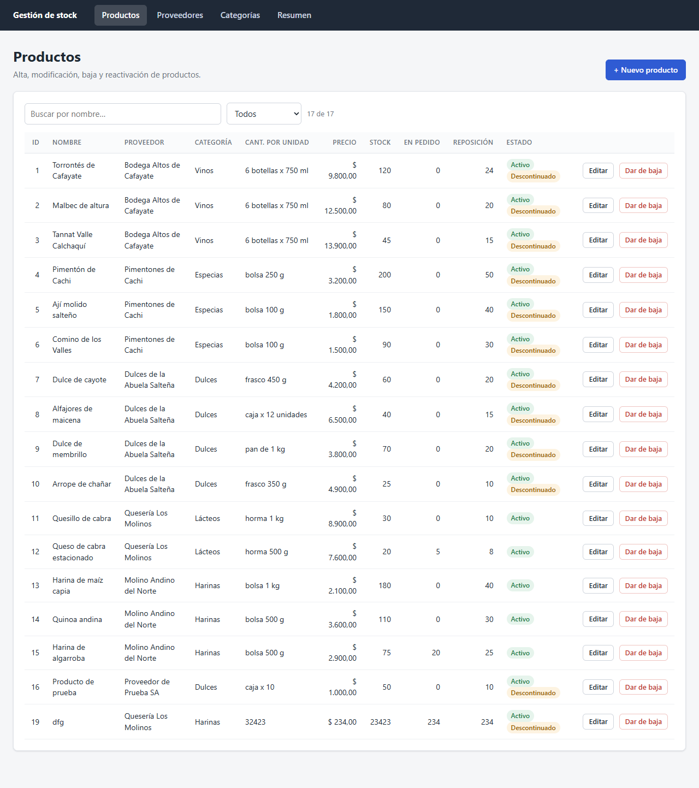
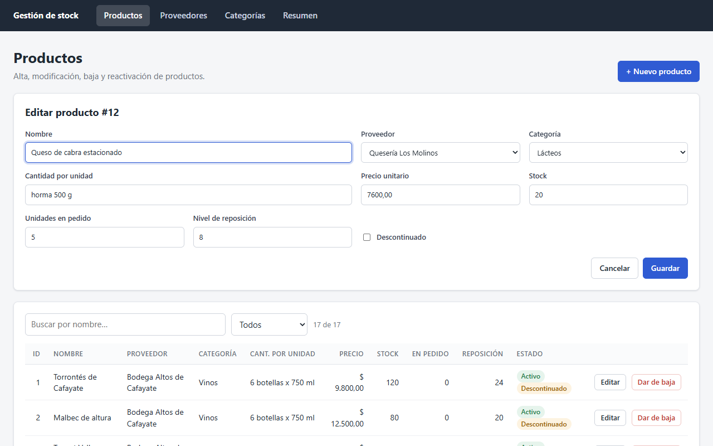
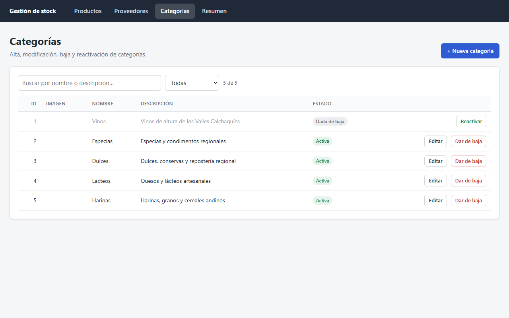
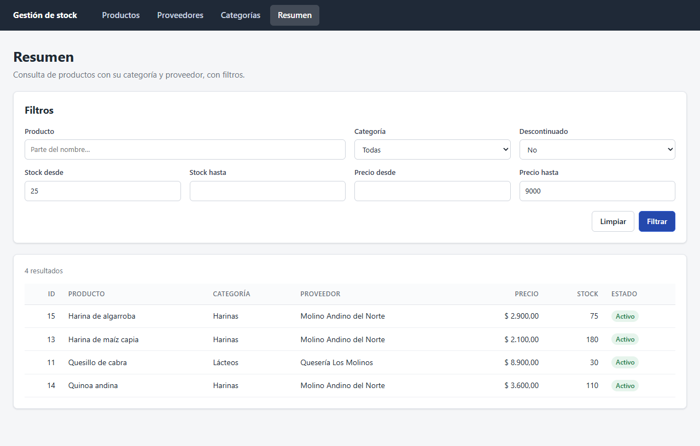

# GESTIÓN DE STOCK — Proyecto DB

PostgreSQL + API REST (FastAPI) + front web (HTML, CSS y JavaScript)  
Última actualización: 25/11/2026

Sistema para administrar **productos, proveedores y categorías**. Las reglas de negocio (datos obligatorios, nombres únicos, bajas lógicas) están en la base de datos, la API las publica por HTTP y el front las usa desde el navegador.


> Front `:5500` → API FastAPI `:8000` → PostgreSQL `:5432`.

## Qué incluye

- **Base `products`**: 3 tablas, 15 funciones, 3 triggers y la vista `vw_resumen`. Scripts en `back/sql/` y dump en `back/db/products.dump`.
- **API REST**: `/products`, `/suppliers`, `/categories` y `/view`. Documentación interactiva en `http://127.0.0.1:8000/docs`.
- **Front**: 4 páginas sin frameworks: Productos, Proveedores, Categorías y Resumen.

## Estructura

```text
Proyecto-DB/
├── README.md, readme.txt   este resumen
├── INSTRUCCIONES_API.txt   guía completa de la API
├── arquitectura.png        diagrama
├── capturas/               8 capturas del front
├── back/
│   ├── db/products.dump    backup de la base
│   ├── sql/                categories, suppliers, products y view
│   └── api/                FastAPI (app/main.py, app/modules/, .env)
└── front/                  index, proveedores, categorías y resumen
```

## Puesta en marcha

1. **Base de datos**: crear `products` y ejecutar en este orden:

   ```bash
   psql -h localhost -U <usuario> -d products -f back/sql/categories.sql
   psql -h localhost -U <usuario> -d products -f back/sql/suppliers.sql
   psql -h localhost -U <usuario> -d products -f back/sql/products.sql
   psql -h localhost -U <usuario> -d products -f back/sql/view.sql
   ```

   También se puede restaurar el dump: `pg_restore -d products back/db/products.dump`.

2. **API** (desde `back/api`, Python 3.11+):

   ```bash
   py -3.13 -m venv .venv
   .venv\Scripts\python.exe -m pip install -r requirements.txt
   .venv\Scripts\python.exe -m uvicorn app.main:app --reload --host 127.0.0.1 --port 8000
   ```

   Crear `back/api/.env` con `POSTGRES_HOST`, `POSTGRES_PORT`, `POSTGRES_DB`, `POSTGRES_USER` y `POSTGRES_PASSWORD` (no se sube a GitHub). En Linux usar `python3` y `.venv/bin/`.

3. **Front**: abrir `front/index.html` con Live Server en `http://127.0.0.1:5500` (o `python3 -m http.server 5500` dentro de `front/`). Abrir con doble clic no funciona por CORS.

## Capturas

### Productos






### Proveedores


### Categorías



### Resumen




## API REST

Base: `http://127.0.0.1:8000` · Swagger: `/docs` · Respuestas en JSON.

| Método | Ruta | Uso |
| --- | --- | --- |
| GET / POST | `/products/` | listar / crear |
| GET / PUT / DELETE | `/products/{id}` | buscar / modificar / dar de baja |
| POST | `/products/{id}/activate` | reactivar |
| GET / POST | `/suppliers/` | listar / crear |
| GET / PUT / DELETE | `/suppliers/{id}` | buscar / modificar / dar de baja |
| POST | `/suppliers/{id}/activate` | reactivar |
| GET / POST | `/categories/` | listar / crear |
| GET / PUT / DELETE | `/categories/{id}` | buscar / modificar / dar de baja |
| POST | `/categories/{id}` | reactivar |
| GET | `/view/` | resumen filtrado |

`GET /view/` acepta `productname`, `categoryname`, `discontinued`, `stockmin`, `stockmax`, `pricemin` y `pricemax`. Ojo: `min` es tope (`<=`) y `max` es piso (`>=`), según `fn_filterView`. Ejemplo: `/view/?stockmax=5&stockmin=100` devuelve stock entre 5 y 100.

Detalle completo de campos y respuestas: `INSTRUCCIONES_API.txt`.

## Base de datos

- `products`: alta, baja lógica (`active`), edición y reactivación. Trigger `tg_validateproduct`.
- `suppliers`: baja lógica descontinúa sus productos. Trigger `tg_validatesupplier`.
- `categories`: baja lógica con `discontinued` y bloqueo de borrado físico. Trigger `trg_am_categorias`.
- `vw_resumen` + `fn_filterView` alimentan la página Resumen y `/view`.

## A tener en cuenta

- Dar de baja no borra la fila: la reactivación la devuelve al estado activo.
- `discontinued` no es lo mismo que inactivo: el producto sigue activo pero no se le aumenta stock.
- Los mensajes de error del front vienen directamente de los `RAISE EXCEPTION` de PostgreSQL.
- La API abre una conexión al arrancar: si se reinicia PostgreSQL, reiniciar también la API.
