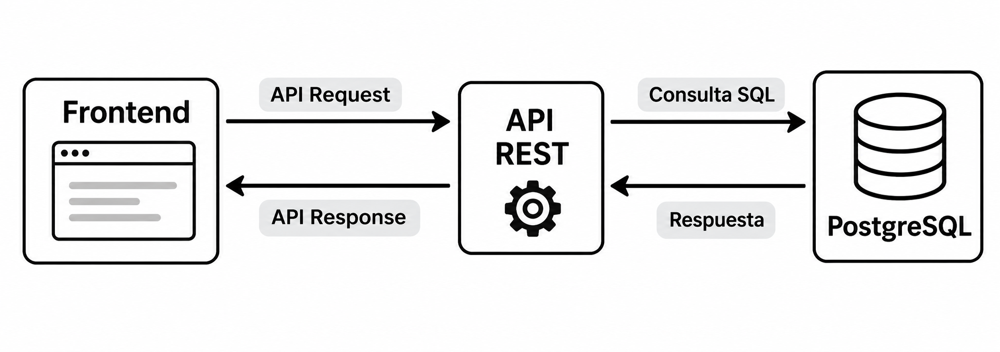
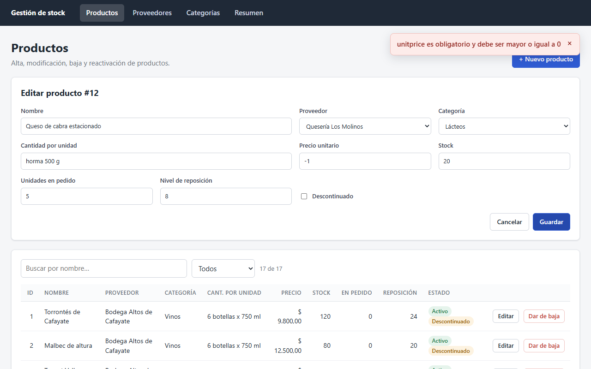
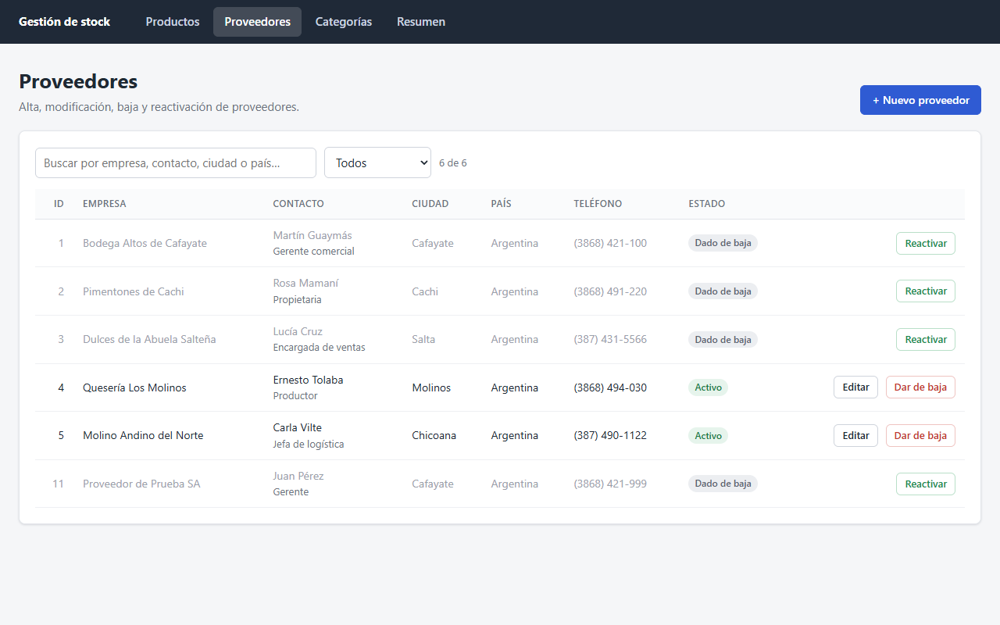
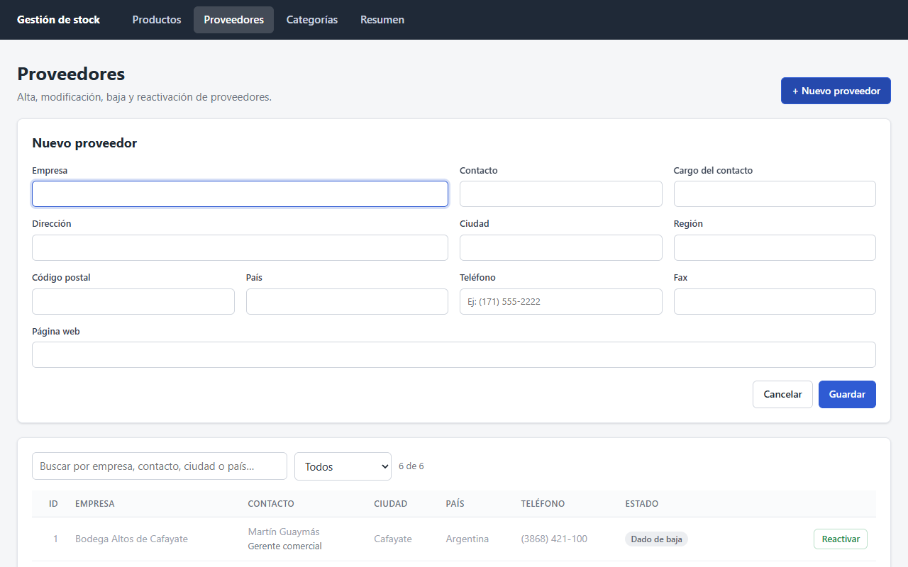
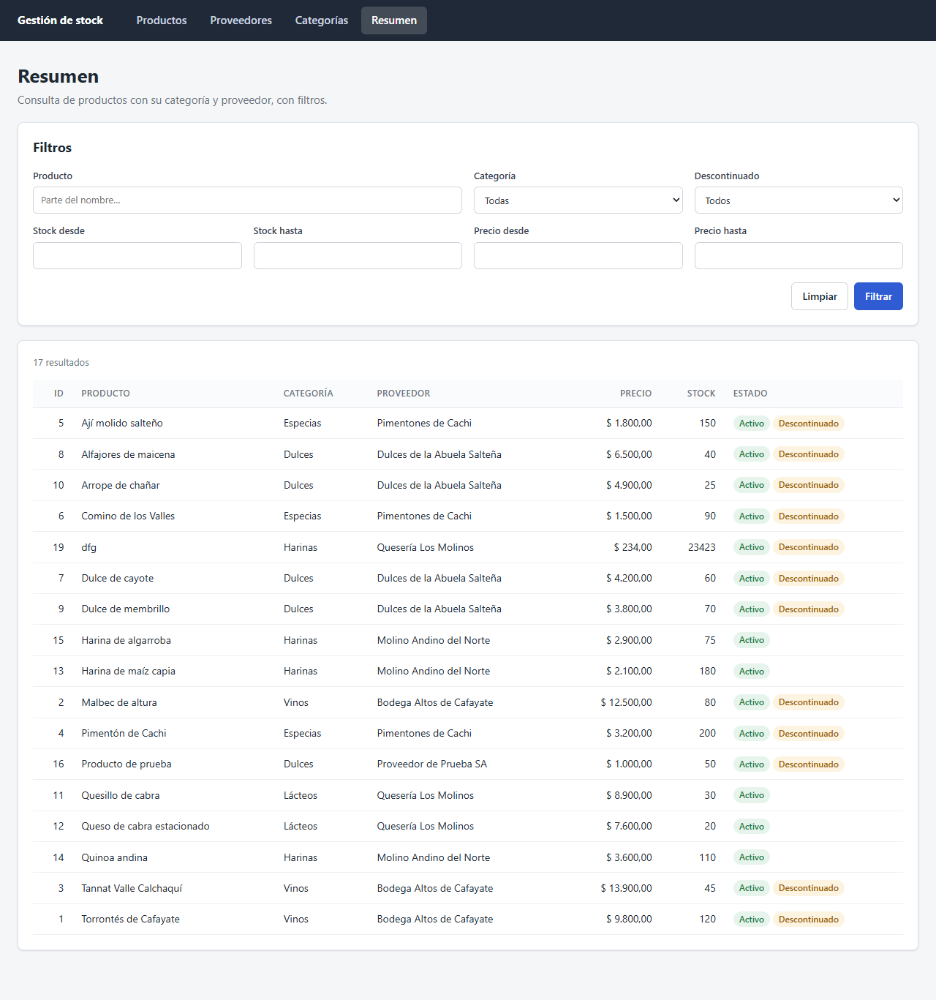

# ABM - Base de Datos

ABM con **soft delete** de las tablas `products`, `suppliers` y `categories`. PostgreSQL + API REST (FastAPI) + front web (HTML, CSS y JavaScript).  
Última actualización: 25/11/2026

La lógica de negocio —validaciones, altas, bajas lógicas y reactivaciones— está **en el servidor de PostgreSQL**, en las funciones y triggers de [`back/sql/`](back/sql/). La API y el front son parte del proyecto y consumen esa lógica, pero el eje de este README es la base de datos.

**Para levantar el proyecto basta con volcar `back/db/products.dump`** en PostgreSQL: el dump trae las tablas con datos, las 15 funciones, los 3 triggers y la vista `vw_resumen`.



> Front `:5500` → API FastAPI `:8000` → PostgreSQL `:5432`.

## Base de datos (contenido principal)

| Tabla | Baja lógica (soft delete) | Trigger |
| --- | --- | --- |
| `products` | `active = false` | `tg_validateproduct` |
| `suppliers` | `active = false` (descontinúa sus productos) | `tg_validatesupplier` |
| `categories` | `discontinued = true` (prohíbe borrado físico) | `trg_am_categorias` |

Scripts en `back/sql/`:

- **`categories.sql`**: agrega la columna `discontinued`, el trigger `trg_am_categorias` y la función `fn_abmr_categorias` (alta, baja, modificación y reactivación).
- **`suppliers.sql`**: trigger `tg_validatesupplier` y funciones de inserción, modificación, baja y reactivación.
- **`products.sql`**: trigger `tg_validateproduct` y funciones de inserción, modificación, baja y reactivación.
- **`view.sql`**: vista `vw_resumen` y función `fn_filterView` (filtros del resumen).

## Estructura

```text
Proyecto-DB/
├── README.md                 este resumen
├── INSTRUCCIONES_API.txt     guía completa de la API
├── back/
│   ├── db/products.dump      volcado de la base (tablas, datos y SQL)
│   ├── sql/                  lógica de negocio: funciones y triggers
│   │   categories.sql, suppliers.sql, products.sql, view.sql
│   └── api/                  API FastAPI (consume la base)
├── front/                    páginas HTML/CSS/JS (consumen la API)
├── capturas/                 8 capturas del front
└── arquitectura.png          diagrama
```

## Puesta en marcha

### 1. Base de datos (lo único imprescindible)

Con la base `products` creada:

```bash
pg_restore -h localhost -U <usuario> -d products back/db/products.dump
```

Como alternativa, se pueden ejecutar los scripts en este orden:

```bash
psql -h localhost -U <usuario> -d products -f back/sql/categories.sql
psql -h localhost -U <usuario> -d products -f back/sql/suppliers.sql
psql -h localhost -U <usuario> -d products -f back/sql/products.sql
psql -h localhost -U <usuario> -d products -f back/sql/view.sql
```

### 2. API (opcional, para usar el front)

Desde `back/api`, con Python 3.11 o superior:

```bash
py -3.13 -m venv .venv
.venv\Scripts\python.exe -m pip install -r requirements.txt
.venv\Scripts\python.exe -m uvicorn app.main:app --reload --host 127.0.0.1 --port 8000
```

Crear `back/api/.env` con `POSTGRES_HOST`, `POSTGRES_PORT`, `POSTGRES_DB`, `POSTGRES_USER` y `POSTGRES_PASSWORD` (no se sube a GitHub). En Linux usar `python3` y `.venv/bin/`.

### 3. Front (opcional)

Abrir `front/index.html` con Live Server en `http://127.0.0.1:5500` (o `python3 -m http.server 5500` dentro de `front/`). Abrir con doble clic no funciona por CORS.

## Capturas

<details>
<summary>Productos (3 capturas)</summary>




</details>

<details>
<summary>Proveedores (2 capturas)</summary>





</details>

<details>
<summary>Categorías (1 captura)</summary>


</details>

<details>
<summary>Resumen (2 capturas)</summary>




</details>

## API REST (resumen)

Base: `http://127.0.0.1:8000` · Swagger: `/docs` · Respuestas en JSON. La API publica lo que ya resolvió la base; no implementa reglas de negocio propias.

| Recurso | Rutas principales |
| --- | --- |
| `/products` | listar, crear, buscar, modificar, baja lógica y reactivar |
| `/suppliers` | listar, crear, buscar, modificar, baja lógica y reactivar |
| `/categories` | listar, crear, buscar, modificar, baja lógica y reactivar |
| `/view` | resumen filtrado (`vw_resumen` + `fn_filterView`) |

En `/view/`, `min` es tope (`<=`) y `max` es piso (`>=`), según `fn_filterView`. Detalle completo de campos y respuestas: `INSTRUCCIONES_API.txt`.

## A tener en cuenta

- Dar de baja no borra la fila: es soft delete y se puede reactivar.
- `discontinued` no es lo mismo que inactivo: el producto sigue activo pero no se le aumenta stock ni unidades en pedido.
- Los mensajes de error del front son los `RAISE EXCEPTION` de PostgreSQL.
- La API abre una sola conexión al arrancar: si se reinicia PostgreSQL, reiniciar también la API.
